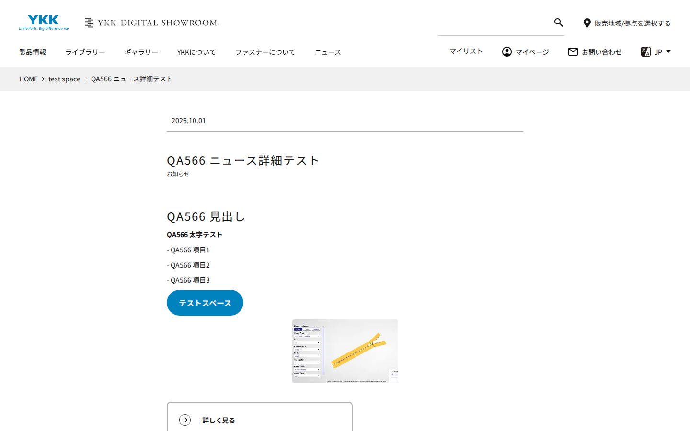
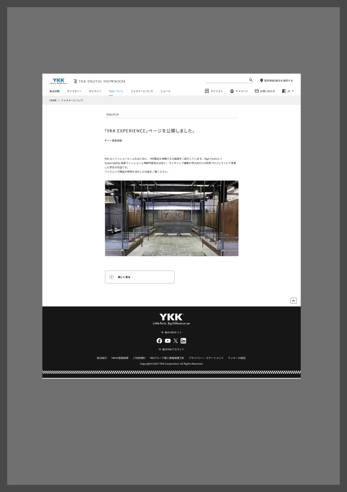
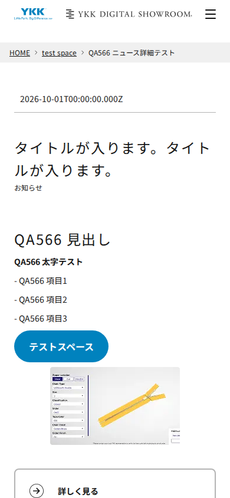
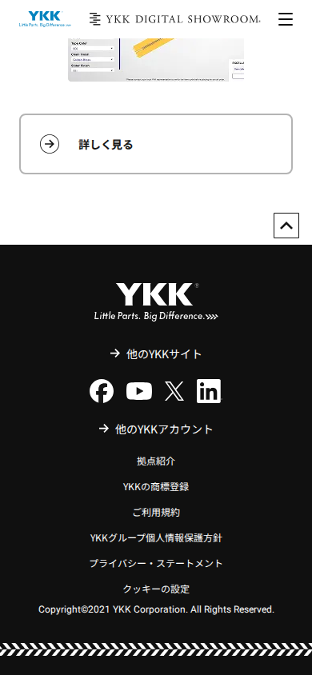
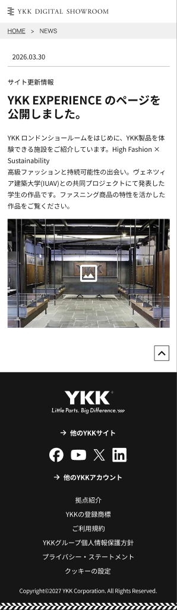

# 👀 L&F card – DSR-566 ニュース詳細 (TC 14.0 PC / 15.0 SP) · DEV · 23/10

**Dat: chọn OK / NG cho từng điểm (≤ 5 phút).** So sánh trang `qa566-news-01` (ja) với Figma PC 6010-59004 / SP 6018-60532. Chỉ xét layout; nội dung chữ/ảnh là data test.
Trang: [ja .live](https://main--dsr-eds-dev--sutrix-projects.aem.live/master/ja/test-space/qa566-news-01) · Figma [PC](https://www.figma.com/design/ILi1KhW94Zb3zcQfzgIBAd/YKK-DSR-%E3%83%87%E3%82%B6%E3%82%A4%E3%83%B3?node-id=6010-59004&m=dev) · [SP](https://www.figma.com/design/ILi1KhW94Zb3zcQfzgIBAd/YKK-DSR-%E3%83%87%E3%82%B6%E3%82%A4%E3%83%B3?node-id=6018-60532&m=dev)
⚠ Ảnh SP chụp 09:42 VN (trước khi agent sửa data 10:33: ngày ISO + tiêu đề placeholder đã được sửa – **bỏ qua 2 chỗ đó**). Ảnh PC chụp 10:40 (sau sửa). Anh có thể mở link trên điện thoại/DevTools 390 để xem bản hiện tại.

| # | Nhìn gì | Ảnh | Claude nghĩ | Chắc |
|---|---|---|---|---|
| 1 | **SP: thứ tự loại tin và tiêu đề.** Figma SP: `サイト更新情報` (loại tin) **ở trên** tiêu đề. DEV SP: tiêu đề trước, `お知らせ` ở dưới (giống PC). Figma PC: loại tin ở dưới tiêu đề | SP-DEV 1 vs Figma SP | NG? (SP phải đổi thứ tự) | 65% |
| 2 | **SP: tiêu đề.** Figma SP: chữ đậm, ~22px. DEV SP: chữ thường, to hơn (giống PC) | SP-DEV 1 vs Figma SP | NG? | 60% |
| 3 | **Khoảng trắng** giữa loại tin và phần body: DEV ~70px (PC + SP), Figma ~30–40px | PC-DEV vs Figma PC | NG? (Spacer template quá lớn) | 50% |
| 4 | **Không có My List / Share** cạnh ngày: Figma PC + SP **cũng không có** (chỉ ngày + gạch) → TC NEWS-012 kỳ vọng sai | Figma PC | OK (sửa TC) | 80% |
| 5 | **Không có "一覧へ戻る / Back to list"**: Figma PC + SP **không có**; nhưng TC 2.0/6.0 lấy từ Toan comment 30/09 #1 ("一覧へ戻るはオーサー配置なしで表示") | Figma PC/SP | Anh chọn: theo Figma (OK, sửa TC) hay theo Toan (NG → bug Ngọc) | – |
| – | Rút lại (data, không phải layout): nút xanh `テストスペース` = link trong body đứng riêng 1 dòng → EDS tự thành nút; ảnh nhỏ = ảnh test kích thước nhỏ; ©2021 ở footer = footer chung, không thuộc 566 | | – | – |
| 6 | Còn lại: header, breadcrumb, ngày + đường gạch, nút CTA `詳しく見る` (khung trắng, icon →), nút lên đầu trang, footer | PC-DEV, SP-DEV 2 | OK | 80% |

## Ảnh
- PC DEV 1440 (10:40) 
- Figma PC 
- SP DEV 390 (09:42) ①  ② 
- Figma SP 

Sau khi Dat trả lời: NG → Claude soạn bug FE (Ngọc) gộp 1–3 nếu cùng nguyên nhân template; #4 OK → sửa kỳ vọng NEWS-012; #5 theo lựa chọn của Dat.
