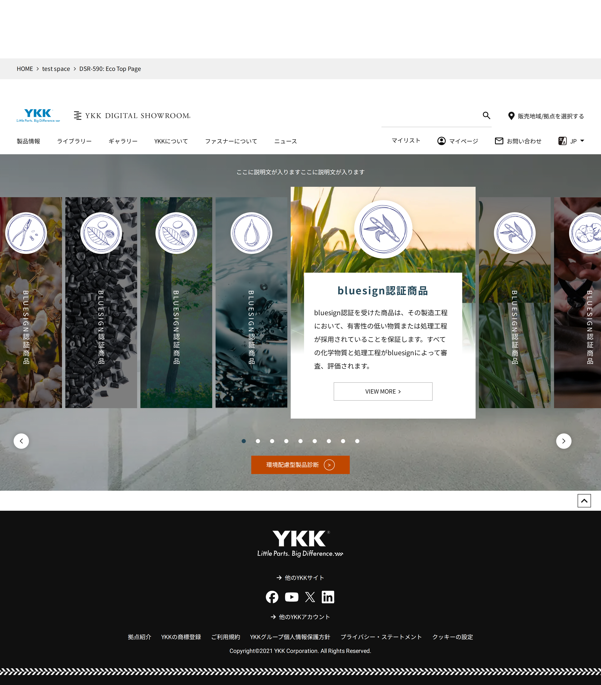
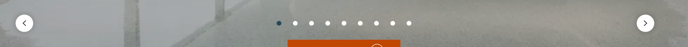
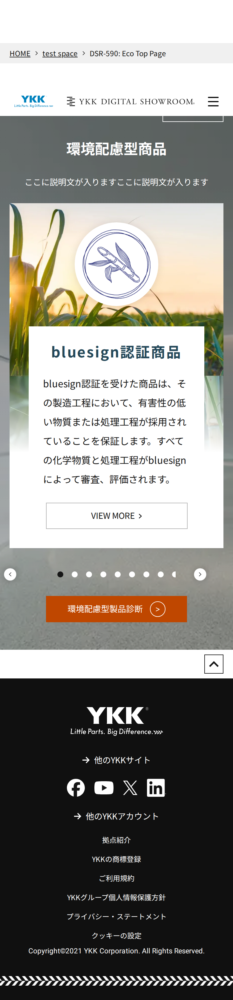
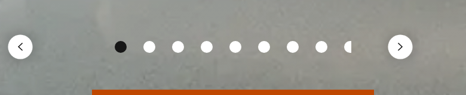
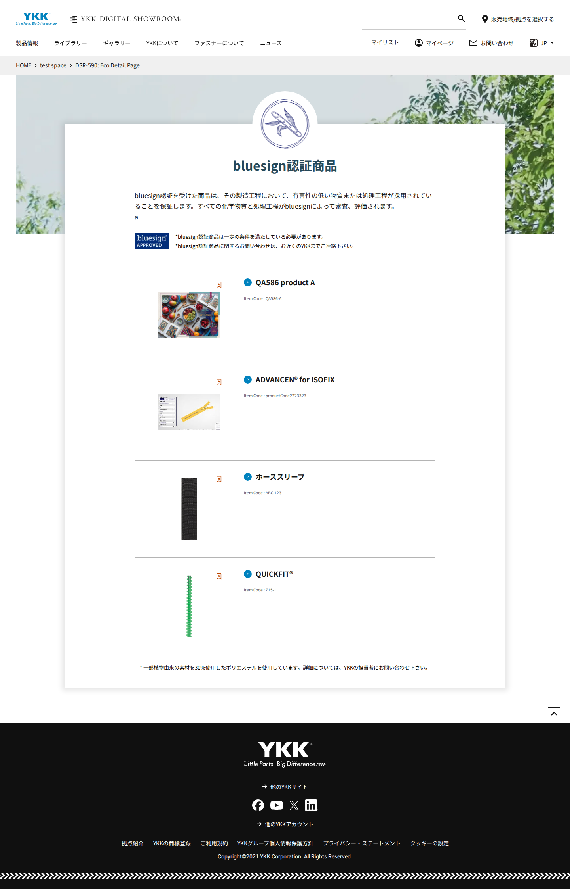
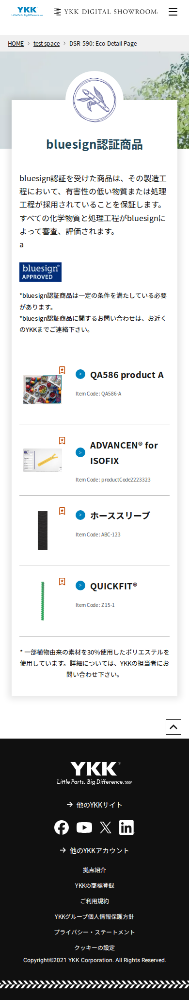

# 👀 L&F card – DSR-590 環境配慮型製品 (Eco TOP C14 + Detail C15) · DEV · 22/10

**Dat: chọn OK / NG cho từng điểm (≤ 5 phút).** Data là demo (Ngọc 21/10) → không xét nội dung chữ/ảnh, chỉ layout.
Trang thật: [TOP](https://main--dsr-eds-dev--sutrix-projects.aem.live/master/ja/test-space/dsr-590-eco-top-page) · [Detail](https://main--dsr-eds-dev--sutrix-projects.aem.live/master/ja/test-space/dsr-590-eco-detail-page) · Figma spec carousel: [3351-51595](https://www.figma.com/design/ILi1KhW94Zb3zcQfzgIBAd/YKK-DSR-%E3%83%87%E3%82%B6%E3%82%A4%E3%83%B3?node-id=3351-51595&m=dev) (frame này là ghi chú chức năng carousel, không phải mockup)

| # | Nhìn gì | Ảnh | Claude nghĩ | Chắc |
|---|---|---|---|---|
| 1 | **TOP: breadcrumb nằm TRÊN header**, phía trên còn 1 dải trắng trống (PC + SP). Trang Detail đúng thứ tự header → breadcrumb | PC ảnh 1 · SP ảnh 3 | NG | 80% |
| 2 | **TOP SP: chấm thứ 9 bị nút ">" che mất nửa** (spec: số chấm = số phần, 10 thì xuống dòng) | ảnh 4 | NG | 85% |
| 3 | TOP: tiêu đề hero "環境配慮型商品" có trên SP nhưng **không có trên PC** | ảnh 1 vs 3 | NG? (cần Dat nhìn) | 60% |
| 4 | TOP SP: 1 khung viền trắng lạ ló ra dưới header, góc phải | ảnh 3 | NG? | 55% |
| 5 | Carousel PC: thẻ chính to ở giữa, tối đa 9 thẻ, 9 chấm, nút < > hai bên, nút cam "環境配慮型製品診断" | ảnh 1, 2 | OK | 85% |
| – | Detail PC/SP: hero + thẻ trắng + icon + logo bluesign + danh sách sản phẩm. Chữ "a" thừa dưới mô tả = data demo, bỏ qua | ảnh 5, 6 | OK | 80% |

## Ảnh
1. TOP PC 1440 
2. TOP PC controls (2×) 
3. TOP SP 390 
4. TOP SP controls (2×) 
5. Detail PC 1440 
6. Detail SP 390 

Nguồn: JOB-20261022-04 (functional 4 pass, ECO-005/006 fail = chờ Figma/data) · JOB-ZZ-IDLE-33 (Lighthouse TOP 92/96, Detail 94/74 desktop).
Sau khi Dat trả lời: NG → Claude soạn bug FE (assignee Ngọc, ảnh card làm evidence); OK → TC L&F "reviewed by Dat".
